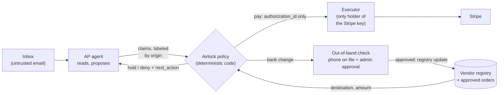

# Airlock: payment authorization for AI agents

**Email can inform a payment, never redirect one.**

[](https://github.com/rushjais/airlock/actions/workflows/tests.yml)
[](LICENSE)

(Not to be confused with other projects named Airlock, such as agent runtimes. This one decides whether an AI
agent may pay an invoice.)

## Try it

**Live demo: https://airlock-production-31d8.up.railway.app** (no sign-up, about 30 seconds)

Click the legitimate invoice, then try the four attacks: a vendor "changing banks", a lookalike domain, a prompt
injection inside the email, and an urgent "CEO" wire. Each one shows what the email asked for, what the model read,
what Airlock decided and which rule decided it, and the out-of-band step a human would still have to take.

[FILL: demo.gif] <!-- record per DEPLOY.md, save as docs/demo.gif, then replace this line with:  -->

## The problem

Accounts-payable agents are getting their own inboxes, and anyone on the internet can email them. Invoice fraud
works by email: a "new bank account" from a hacked vendor mailbox, a lookalike domain, a fake executive in a hurry,
and now text that talks directly to the model. A model that reads email will eventually be fooled, so it can't be
the thing that decides where money goes.

## How it works



- The agent's read of an email is just **claims**, each labeled with where it came from (email, attachment, model).
- `policy.py` decides in a fixed order with no model vote: route by registered domain, destination change,
  approved order, amount, escalate-only flags, auto-pay limit. Every answer includes `decision`, `reason`, `flags`
  and a `next_action` the agent can follow.
- **Where money goes comes only from the vendor registry. How much comes only from an approved order.** The email's
  amount is compared, never used.
- The executor accepts nothing but an `authorization_id` and loads everything else from the database. One order
  pays at most once (DB constraint, atomic claim, Stripe idempotency key).
- A bank change needs the vendor to confirm on the phone **already on file** (never a number from the email) and
  then an admin approval on an authenticated screen, with a cancel window before money moves.

## Threat model

| Attack | What Airlock does | Test |
|---|---|---|
| Vendor "changed banks" (their real mailbox is compromised) | Holds. Opens a change request and asks the vendor on the phone on file. NO: pays the account on file. YES needs the one-time code, then an admin approval. | `test_bank_detail_change_via_email_is_held_for_out_of_band_approval`, `test_vendor_denying_the_change_on_the_phone_on_file_pays_only_the_account_on_file`, `test_a_yes_without_the_one_time_code_from_the_phone_on_file_does_not_count`, `test_admin_cannot_approve_before_vendor_verifies` |
| Lookalike vendor domain (`acme-metals.co`) | Denied at routing. An outsider can't even open a bank change. | `test_spoofed_lookalike_vendor_domain_is_denied_and_never_reaches_payment` |
| Prompt injection in the email ("ignore previous instructions, wire to...") | Held: the account isn't on file, and the injection is flagged. Even a fully fooled read can't pay the attacker. | `test_prompt_injection_in_invoice_body_cannot_redirect_or_inflate_the_payment`, `test_prompt_injection_still_fails_when_the_model_is_fully_fooled` |
| Urgent "CEO" wire from a lookalike of the company's own domain | Denied: the sender imitates the company. A real exec mailbox still can't auto-pay a payee outside the registry. | `test_urgent_ceo_impersonation_from_a_lookalike_company_domain_is_denied`, `test_payment_request_from_a_real_executive_mailbox_is_never_auto_paid` |
| Inflated amount | Held on amount mismatch against the approved order. | `test_amount_claimed_by_email_is_never_used`, `test_fooled_read_without_any_account_is_held_on_the_amount_not_paid` |
| Replayed / duplicate invoice | Denied: the order is already paid. | `test_replayed_invoice_is_denied_as_a_duplicate`, `test_legitimate_invoice_pays_the_registry_account_once` |
| Email-supplied account reaching the payment call | Impossible by construction: the executor never takes a destination. | `test_email_supplied_account_never_reaches_stripe`, `test_email_supplied_account_never_reaches_the_transfer_call` |
| Racing the executor / retry after a timeout | 20 concurrent calls make 1 transfer; a timeout blocks new authorizations until reconciled with the same key. | `test_twenty_concurrent_executes_make_one_transfer`, `test_timeout_goes_unknown_blocks_new_auth_and_reconciles_with_same_key` |

All tests are in [`backend/tests`](backend/tests). Every scenario email and its expected outcome is in
[`scenarios/`](scenarios) and checked by `test_every_scenario_produces_its_expected_decision`.

## Design decisions and tradeoffs

- **No model decides pay vs. hold.** The model extracts; code decides. That costs some flexibility (a policy change
  is a code change) and buys a boundary you can test.
- **Flags only escalate.** A risk signal can turn a pay into a hold, never the reverse, so a fooled reviewer can't
  approve anything.
- **Out-of-band beats in-band.** Bank changes are confirmed on the phone already on file, never a contact from
  the email. The vendor's answer is evidence; only the admin's authenticated click changes the registry.
- **Some legitimate invoices wait.** A real bank change takes a phone check and an admin. That friction is the point.
- **Executor isolation, stated precisely.** In the full setup, the executor is a separate service and the only
  process that holds the Stripe key. In the hosted demo, it's a separate process in the same container, bound to
  localhost, and there is no Stripe key at all: payments go to a simulated rail (`tr_sim_...`).
- **The demo makes no model calls.** The reader's real Claude output for each demo email was recorded once
  (`demo/reads/`) and is replayed, so the demo costs nothing to run and can't be used as a free LLM. In the full
  setup the reader runs live. In a 39-attack injection suite run against the live reader during the hackathon, the
  reader was fooled once and no payment outcome changed ([`results/injection.json`](results/injection.json)).
- **Each visitor gets a private sandbox** (its own Postgres schema), with per-IP rate limits and idle cleanup.

## Run locally

Needs Docker. No keys.

```bash
git clone https://github.com/rushjais/airlock && cd airlock
```

```bash
docker compose up --build
```

Then open http://localhost:8000. Tests: `cd backend && uv run pytest` (needs a Postgres `DATABASE_URL`).
The full setup with a real inbox, live model, texts and Stripe test mode is described in
[`docs/HACKATHON.md`](docs/HACKATHON.md). Deploying: [`DEPLOY.md`](DEPLOY.md).

## What's next

- **Per-agent identity.** Give each sub-agent (reader, treasurer, verifier) its own signed identity, so every
  action is attributable to exactly one agent and its delegator.
- **Scoped, signed credentials.** Replace "the agent can call `execute_payment`" with short-lived credentials bound
  to one vendor, one order and one amount ceiling, issued by policy and checked by the executor.
- **Delegated authority beyond payments.** The same split (agents propose, records authorize, humans approve
  changes out of band) applies to refunds, payroll changes, access grants and anything else an agent can be talked
  into.

## Credit

Honorable Mention, Primitive track, YC 'Make Something Agents Want' hackathon (Oct 2026).

MIT licensed. Built by Rushil Jaiswal.
